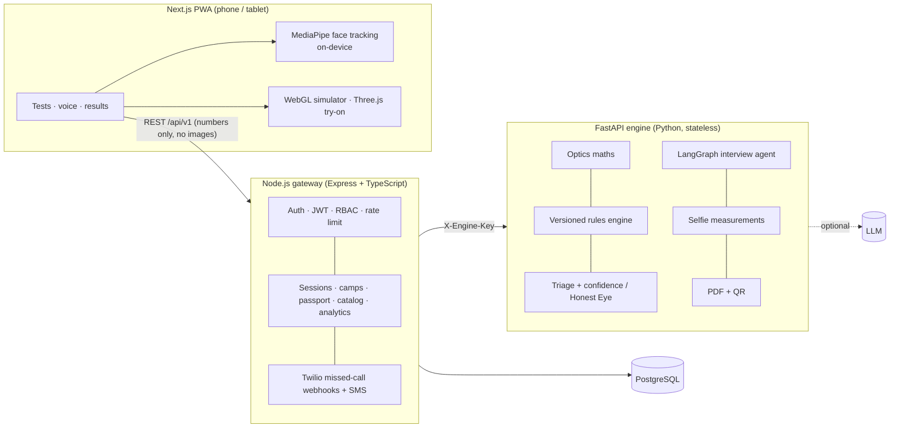

# Ocula — an eye clinic in every phone

**ZEISS India Hack · No-Device Vision Intelligence & Accessible Clinical UX · Team Container_Service**

Ocula turns any optical counter with just a phone into a vision screening and lens-advice point. In about 7 minutes a walk-in customer gets an **estimated vision profile with a confidence score**, **PD and frame-fit measurements**, an **explainable ZEISS lens recommendation**, and a **doctor referral whenever something looks wrong**.

> Ocula is a screening and retail-assist tool. Its output is an *estimated vision profile*, never a prescription or diagnosis.

## Architecture — three services



| Service | Folder | Owns |
|---|---|---|
| **Frontend** — Next.js 15, React 19, Tailwind | `frontend/` | Screening wizard, 8 on-screen tests, voice UI, results, simulator, AR try-on, kids game, missed-call demo, staff dashboard, offline PWA |
| **Gateway** — Node.js 22, Express 5, TypeScript, PostgreSQL | `gateway/` | The public `/api/v1`: auth & roles, data (sessions, customers, camps, catalog, audit log), Vision Passport, analytics, Twilio telephony, rate limiting, metrics |
| **Engine** — Python 3.12, FastAPI, LangGraph | `engine/` | Clinical intelligence: optics, rules engine, triage, confidence (Honest Eye), interview agent, selfie maths, explanations, PDF/QR. Stores nothing. |

The gateway keeps all state (including the interview agent's state) and calls the engine with a shared secret. Locally the gateway falls back to **PGlite** (real Postgres in WASM), so you don't need a database server to try it.

## Features

* **Calibration** — bank-card screen sizing; live face-to-screen distance from iris size; lighting check; optional A4-sheet focal calibration.
* **Voice interview** — LangGraph agent in English / Hindi / Odia (any language with an LLM); speech in & out; red-flag interrupt on any reply.
* **Tests** — adaptive tumbling-E acuity (distance-corrected), far point → myopia, near point → reading add, clock-dial astigmatism + axis, red/green duochrome, contrast, generated colour plates, Amsler grid.
* **Selfie** — PD, face shape, eyelid symmetry, Hirschberg squint check; only landmarks leave the phone.
* **Recommendation** — YAML rules → design, index, coatings, features, second pair, frames; confidence gating; LLM only rewrites the explanation.
* **Safety** — urgent / soon / routine triage, retail paused on urgent cases, consent screen, audit log.
* **Reports** — PDF, WhatsApp share, QR Vision Passport with history and child myopia progression.
* **01 See Through My Eyes** · **02 Lens-thickness AR try-on** · **03 Honest Eye** · **04 Kids mode + school camps** · **05 Missed-call check** · **Store dashboard** · **Offline-first PWA**

## Run locally

Requirements: Python 3.12, Node.js 22.

### 1. Create your env files (never committed)

```bash
cp engine/.env.example   engine/.env
cp gateway/.env.example  gateway/.env
cp frontend/.env.example frontend/.env.local
```

Fill in `gateway/.env` and `engine/.env`. Generate each secret with `openssl rand -hex 32`:

| File | Variable | Value |
|---|---|---|
| `gateway/.env` | `SECRET_KEY` | random, signs login tokens |
| `gateway/.env` | `ADMIN_PASSWORD` | your staff dashboard password (no admin is created while empty) |
| `gateway/.env` + `engine/.env` | `ENGINE_API_KEY` | random, **the same value in both files** |

### 2. Start the three services (3 terminals)

```bash
# Engine — http://localhost:8001 (API docs: /docs)
cd engine && python3 -m venv .venv && source .venv/bin/activate
pip install -r requirements-dev.txt
uvicorn app.main:app --port 8001

# Gateway — http://localhost:8000 (health: /healthz, engine check: /readyz)
# Uses embedded PGlite in ./data unless DATABASE_URL is set.
cd gateway && npm install && npm run dev

# Frontend — http://localhost:3000
cd frontend && npm install && npm run dev
```

Staff dashboard: `http://localhost:3000/dashboard`. Sign in with `ADMIN_EMAIL` / `ADMIN_PASSWORD` from `gateway/.env`.

### Or with Docker

```bash
cp .env.example .env   # fill in every value
docker compose up --build
```

> Phones only allow camera and microphone over HTTPS. Deploy (below) or use a tunnel such as `ngrok http 3000` to test on a real phone.

## Secrets & configuration

* All secrets live in `.env` files, which are gitignored (`.env`, `.env.*`). Only the `.env.example` templates, holding placeholders, are committed.
* No password or key has a usable default in the code. The gateway refuses to start in production without `SECRET_KEY` and `ADMIN_PASSWORD`.
* On Render, `SECRET_KEY` and `ENGINE_API_KEY` are generated for you. You enter `ADMIN_PASSWORD` (and optional LLM / Twilio keys) in the Render dashboard; they never go in the repo.
* The admin user is created on the gateway's first start. Changing `ADMIN_PASSWORD` later doesn't change an admin that already exists in the database.

## Deploy

1. Push this folder to a new GitHub repository:

   ```bash
   git init && git add . && git commit -m "Ocula"
   git branch -M main
   git remote add origin https://github.com/<you>/ocula.git
   git push -u origin main
   ```

2. Render → **New → Blueprint** → pick the repo. `render.yaml` creates Postgres, the engine, the gateway and the frontend.
3. When asked, set `ADMIN_PASSWORD`. Leave the optional `LLM_*` / `TWILIO_*` values empty if you don't use them.
4. When the deploy finishes, open `https://ocula-api….onrender.com/readyz`; it should report the engine as `ok`.

**[DEPLOY.md](DEPLOY.md)** covers the details: hosting the frontend on Vercel, free-tier sleep behaviour, optional integrations, and a production checklist.

## Tests

```bash
cd engine   && pytest -q && ruff check app tests   # optics, rules, extraction, triage, engine API
cd gateway  && npm test                            # API tests against a fake engine + in-memory PGlite
cd frontend && npm run typecheck && npm run build
```

CI (`.github/workflows/ci.yml`) runs all of these on every push, and also runs the gateway suite against the real engine and Postgres.

## API (gateway, `/api/v1`)

| Area | Endpoints |
|---|---|
| Auth | `POST /auth/login` · `POST /auth/refresh` · `GET /auth/me` · `POST/GET /auth/users` (admin / manager) |
| Screening | `POST /sessions` · `GET /sessions` (staff) · `GET /sessions/:id` · `POST /sessions/:id/calibration` · `PATCH …/profile` · `POST …/tests` · `POST …/selfie` · `POST …/complete` · `GET …/report.pdf` · `POST …/outcome` (staff) |
| Interview | `POST /interview/:id/start` · `POST /interview/:id/reply` |
| Kids & camps | `GET /kids/:customerId/progression` · `POST/GET /camps` · `GET /camps/:id` · `POST /camps/:id/students` · `GET /camps/:id/report.pdf` |
| Passport | `GET /passport/:token` · `GET /passport/:token/qr.png` |
| Catalog | `GET /catalog` · `POST /catalog` · `PUT/DELETE /catalog/:sku` (manager+) |
| Analytics | `GET /analytics/summary?days=30` |
| Telephony | `POST /telephony/missed-call` · `POST /telephony/voice/:id` · `POST /telephony/gather/:id` · `POST /telephony/simulate` · `POST /telephony/simulate/:id/reply` |
| Lens | `POST /lens/thickness` |

Devices write to a session with the `X-Session-Token` returned by `POST /sessions`; staff use `Authorization: Bearer`. Engine API docs: `http://localhost:8001/docs`.

## How the measurements work

* **Letter size:** a 6/6 letter subtends 5 arcmin → 1.454 mm per metre; logMAR L scales by 10^L, using card px/mm and live distance.
* **Distance:** `d = f · 11.7 mm / iris_px` (mean visible iris ≈ 11.7 mm).
* **Myopia:** far point d → sphere ≈ −1/d (reliable ≈ −1 to −6.5 D), fused with distance acuity and duochrome into an estimate with a range.
* **Reading add:** amplitude = 1/near-point + distance Rx; add = 2.50 − amplitude/2.
* **Astigmatism:** darkest clock line → minus-cyl axis = lower clock hour × 30°.
* **PD / squint:** iris-centre distance × (card or iris scale); Hirschberg ≈ 22 Δ per mm of reflex asymmetry.
* **Lens thickness:** sag formula, r = (n−1)/|F|, over the frame's effective diameter with decentration.

## Limitations (stated openly)

* Phone far-point testing is reliable for roughly −1 to −6 D; low hyperopia and low astigmatism are hard without a phoropter, so Ocula widens ranges and lowers confidence instead of guessing.
* Hindi / Odia text was drafted for the prototype and should be reviewed by native speakers; the Twilio phone flow supports English and Hindi voices.
* ZEISS product names in the seed catalog are recommendation targets; verify names, availability and prices in the catalog editor.
* Recommendation thresholds live in `engine/app/domain/rules/ruleset_v1.yaml`; triage and confidence thresholds in `triage.py` / `confidence.py`. All need clinical validation before real-world use.
